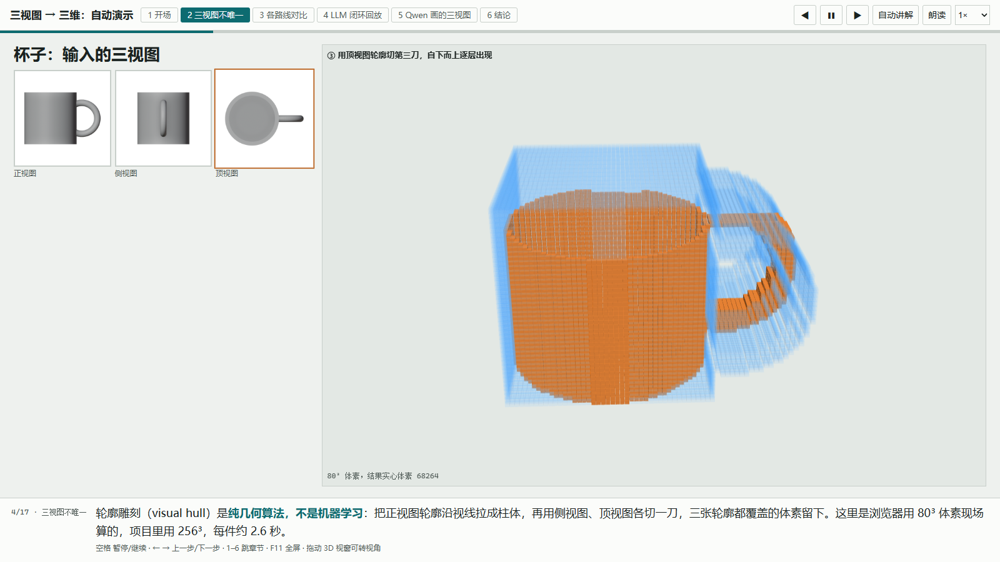
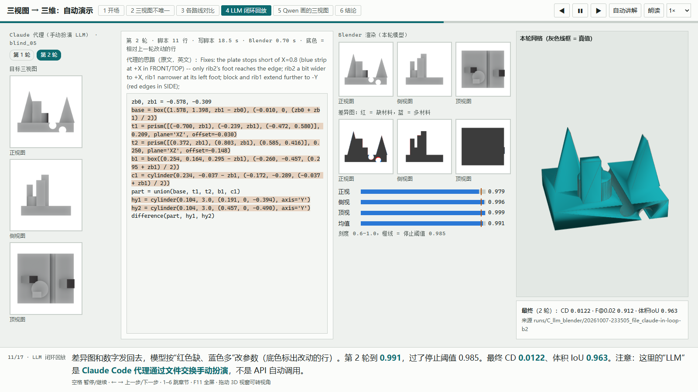

# 三视图到三维：AI 建模路线实验台

给 AI 一张正视图、侧视图、顶视图，它能建出准确的 3D 模型吗？本项目把五条路线放在同一把“有真值的尺子”上量了一遍，并做成可以直接在浏览器里播放的自动演示。

作者：Shuyao Gao（gaoshuyao.mk@gmail.com）· aSSIST University (Seoul School of Integrated Sciences and Technologies) · 서울과학종합대학원대학교
**AI 教学演示案例 / AI Teaching Demos 系列**

在线演示：https://shuyaogao.github.io/multiview-to-3d-lab/


*第 4 步：浏览器现场做轮廓雕刻（正视图拉伸 → 侧视图切一刀 → 顶视图切一刀）。*


*第 11 步：LLM 写 Blender 脚本 → 渲染 → 与目标比对 → 按差异图修改，第 2 轮达到停止阈值。*

> **数据说明**：评测用的 16 个物体全部是合成数据（程序化生成的形体，加上 Keenan Crane 的 CC0 模型 Spot、Bob），输入三视图是用 Blender 渲染的灰模图，不是照片。

## 怎么打开

- **手机 / 电脑**：点上面的在线链接。打开后自动播放（6 章 17 步，1× 约 5 分钟）。
- **电脑离线**：Code → Download ZIP，解压后双击根目录的 `index.html`（或 `demo/index.html`）。不需要安装、不需要联网。
- 想自己逐件旋转对比：打开 `showcase/index.html`。

演示页只回放已有结果，**不加载任何模型、不联网、没有后台进程**，关掉标签页就全部结束。

## 怎么用

| 操作 | 电脑 | 手机 / 平板 |
|---|---|---|
| 暂停 / 继续 | 空格，或顶栏 ❚❚ | 点顶栏 ❚❚ |
| 上一步 / 下一步 | ← / →（翻页笔也可以） | 点顶栏 ◀ / ▶ |
| 跳到第 N 章 | 数字键 1–6，或点章节名 | 点章节名 |
| 转 3D 视角 | 在 3D 视窗里拖动，松手 2.5 秒后恢复自动旋转 | 单指拖动 |
| 从某一步打开 | 地址后加 `?step=8`，再加 `&autoplay=0` 不自动翻页 | 同左 |

页面按 16:9 投影设计，手机上建议横屏查看。完整讲法见 [DEMO_GUIDE.md](DEMO_GUIDE.md)。

## 课堂上怎么用

- **5 分钟**：开着“自动讲解”从头放到尾，照底部字幕讲。
- **10 分钟**：关掉“自动讲解”，每步讲完按 →。建议在“杯子是不是空心的”（第 3 步）先让同学猜，再看雕刻结果。
- 关键结论：三视图本身不唯一；硬表面零件上“LLM 写建模代码 + 渲染比对”最准；角色、有机体上原生多视图→3D 模型更好；用图像模型补画三视图是整条 AI 链路的瓶颈。

## 五条路线和主要数字

数字全部来自各次运行的 `result.json`，汇总在 [docs/REPORT.md](docs/REPORT.md)。指标单位是归一化世界坐标（物体最长边 = 1.6）。

| 路线 | 做法 | 盲测零件 6 件 Chamfer↓ | 体积 IoU↑ |
|---|---|---|---|
| D 轮廓雕刻 | 三张轮廓求交（纯几何，无模型） | 0.0264 | 0.777 |
| C 闭环·规则 mock | 同一闭环，规则代替 LLM | 0.0251 | 0.813 |
| C 闭环·Claude 代理 | LLM 写 Blender 脚本 → 渲染比对 → 修改 | **0.0091** | **0.942** |
| A Pixal3D-MV | 正 + 侧视图 → 3D 扩散模型 | 0.0450 | 0.485 |
| A Hunyuan3D-2mv | 正 + 侧视图 → 3D 扩散模型 | 0.0365 | 0.668 |
| A TRELLIS.2 | 只用正视图 | 0.0909 | 0.143 |
| B 转台视频 → VGGT | 理想转台视频 → 深度 → TSDF | 0.0181 | 0.821 |

必须说明的局限：

- “Claude 代理”一行是 **Claude Code 代理通过文件交换手动扮演 LLM** 得到的，不是 API 自动调用；盲测零件生成器也是同一代理写的，数字应视为上限。
- A、B 两类用真值做了相似变换对齐，数字偏乐观；每条路线只跑了 1 个种子。
- B 用的是 Blender 渲染的理想视频；MiniMax H3 等生成视频的几何一致性没有测。
- Hunyuan3D-2mv 的许可证不适用于韩国等地区，所以本仓库**只公开它的评测指标，不公开它生成的网格和渲染图**（见 [THIRD_PARTY.md](THIRD_PARTY.md)）。

## 它是怎么做的

- **基准**：16 个物体，标准第三角正交三视图（512 px），精确轮廓掩码；指标为 Chamfer、F-score@0.02/0.05、体积 IoU（128³）、三视图轮廓 IoU。
- **路线 D**：`src/p6/routes/visual_hull.py`，256³ 体素；演示页里的雕刻动画用浏览器现场算的低分辨率体素。
- **路线 C**：`src/p6/routes/llm_blender.py` + `blender_scripts/p6h.py`（极简 CSG 建模 API）；provider 支持 Claude、OpenAI 兼容端点、文件交换和规则 mock。
- **路线 A / G**：ComfyUI 原生节点（`comfy_workflows/`、`src/p6/comfy/`）。
- **路线 B**：`src/p6/routes/video_recon.py`（Blender 转台渲染 → VGGT → TSDF）。
- 模型与工具调研（每条带来源）：[docs/LANDSCAPE.md](docs/LANDSCAPE.md)。

## 想自己跑

需要 Windows 或 Linux、Python 3.12、Blender 5.2（便携版放 `tools/blender/`，或用环境变量 `P6_BLENDER` 指定）。

```powershell
python -m venv .venv
.venv\Scripts\python -m pip install torch torchvision --index-url https://download.pytorch.org/whl/cu128
.venv\Scripts\python -m pip install -r requirements.txt
$env:PYTHONPATH = "src"
.venv\Scripts\python bench\build.py --blind 6                                # 生成基准
.venv\Scripts\python -m p6.routes.visual_hull --cases all                    # 路线 D（不需要 GPU）
.venv\Scripts\python -m p6.routes.llm_blender --provider mock --cases all    # 路线 C 闭环（规则 mock）
.venv\Scripts\python -m p6.routes.llm_blender --provider anthropic --cases blind   # 真 LLM（需要 ANTHROPIC_API_KEY）
```

路线 A、B、G 需要 GPU 和约 40 GB 权重（`python -m p6.fetch …` 按清单下载并校验 sha256），各模型许可证见 [THIRD_PARTY.md](THIRD_PARTY.md)。
重建演示素材：`python showcase/build_assets.py`、`python demo/build_demo_assets.py`（都要先有 `runs/` 里的结果）。

## 目录结构

```
index.html            入口，跳转到 demo/index.html
demo/                 自动演示页（17 步）及其素材
showcase/             可旋转对比的展示页；assets/ 里是网格、图片和 three.js
src/p6/               视图约定、指标、对齐、各路线实现、ComfyUI 客户端、汇总
blender_scripts/      在无头 Blender 里运行的建模、渲染、简化脚本
bench/                评测基准的形体脚本和生成器
comfy_workflows/      ComfyUI API 格式工作流
train/                “训练自己的模型”的合成数据管线原型
docs/                 REPORT.md（结果）、LANDSCAPE.md（调研）、img/
启动演示.bat           Windows 本地双击打开演示页（在线版不需要）
```

## 常见问题

- **3D 视窗是空的？** 浏览器关闭了硬件加速（WebGL 不可用）。图片和字幕不受影响。
- **会在电脑上留下后台进程吗？** 不会。这是纯静态网页，关掉标签页就全部结束。
- **能拿去商用吗？** 本仓库代码 MIT、文档 CC BY 4.0 可以；但演示里的 Qwen-Image-2.1 生成图和 VGGT 重建网格只限非商业用途，见 [THIRD_PARTY.md](THIRD_PARTY.md)。

## 许可证与引用

代码 MIT（[LICENSE](LICENSE)），文档与教学素材 CC BY 4.0（[LICENSE-docs](LICENSE-docs)），使用请注明出处。第三方组件和模型输出见 [THIRD_PARTY.md](THIRD_PARTY.md)；引用格式见 [CITATION.cff](CITATION.cff)。

## AI 辅助开发声明

代码由 Claude Code 辅助编写，经作者审阅。路线 C 里“Claude 代理”的建模脚本由 Claude Code 代理在闭环中生成，演示中已明确标注。

## English summary

**Multiview-to-3D Lab** asks a simple question: given a front, side and top view, can AI build an accurate 3D model? Five routes are measured on a small synthetic benchmark (16 objects with ground truth, including 6 blind random parts): silhouette carving (visual hull), an LLM writing Blender code in a render-and-compare loop, native multi-view-to-3D diffusion models (Pixal3D-MV, Hunyuan3D-2mv, TRELLIS.2 via ComfyUI), turntable video to VGGT reconstruction, and three-view sheets generated by Qwen-Image-2.1. On the blind parts the LLM loop was most accurate (Chamfer 0.0091 vs 0.0264 for carving), with the caveat that the "LLM" was a Claude Code agent acting through file exchange, not an unattended API run; diffusion models did better on organic shapes; generated side/top views were the weakest link (silhouette IoU about 0.48/0.45). The browser demo auto-plays 17 steps with rotating 3D results and runs fully offline. Hunyuan3D-2mv meshes are not redistributed because of that model's territorial license terms; only its metrics are reported. By Shuyao Gao, aSSIST University. Code MIT, docs CC BY 4.0. Part of the AI Teaching Demos series.
