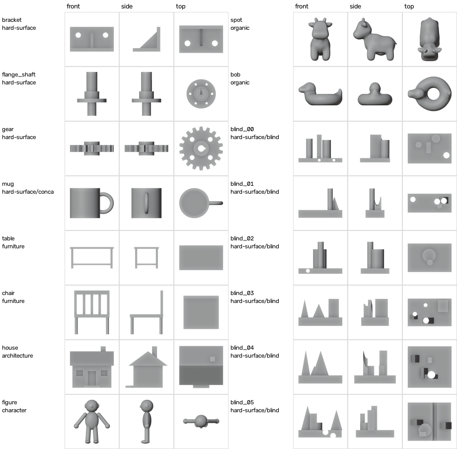
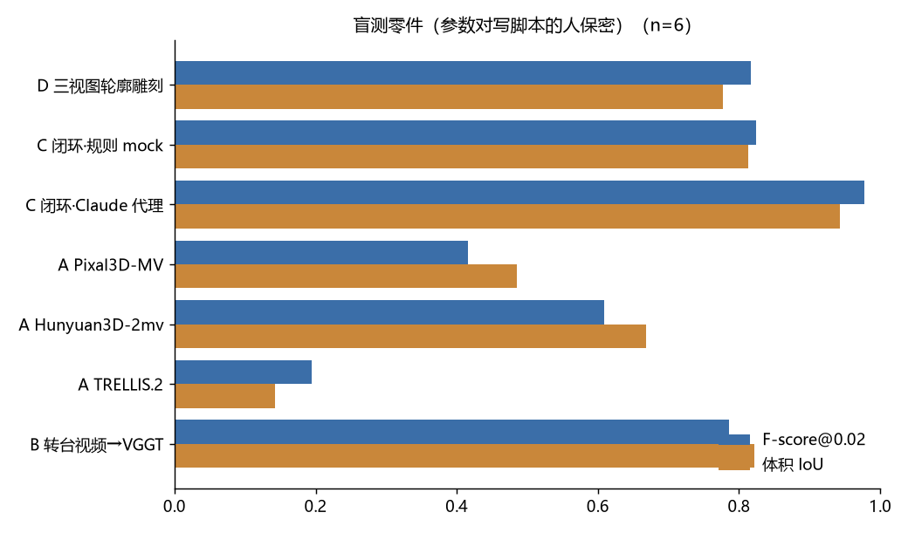
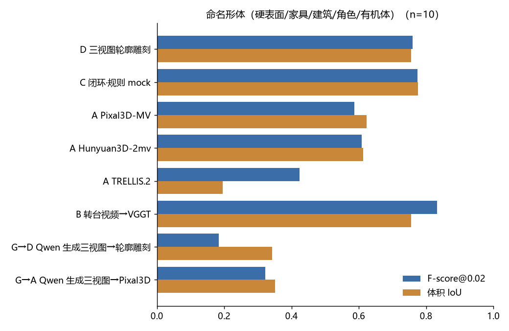

# REPORT：AI 三视图 → 3D 建模，各路线实测

> 日期 2026-10-08。机器：一台 RTX 5090 Laptop（24GB，与其他任务共享，本项目预算约 12GB）。没有任何 API key。
> 所有数字来自 `runs/**/result.json`，由 `python -m p6.report` 汇总到 `runs/report/tables.md` 和 `summary.json`。
> 表里“Claude 代理”一行是 **Claude Code 代理通过文件交换手动扮演 LLM** 得到的（读目标图、写 bpy 脚本、看差异图再改），不是 API 自动闭环。局限见 §3.2。

## 0. 结论

1. **三视图本身不唯一。** 只靠三张轮廓求交（路线 D），16 件的轮廓 IoU 是 0.981，体积 IoU 却只有 0.763。三视图对得上，三维不一定对。典型错误：
   - 杯子内腔被填实（体积 IoU 0.329）；
   - 支架的三角筋被拉成整块楔形（0.565）；
   - 圆柱轴套被雕成方柱。
2. **硬表面：LLM 写建模代码 + 渲染比对闭环最准。** 6 个参数保密的盲测零件上，Claude 代理平均 1.7 轮收敛：
   - Claude 代理：Chamfer **0.0091**、F@0.02 **0.977**、体积 IoU **0.942**；
   - 轮廓雕刻：0.0264 / 0.817 / 0.777；
   - 同一闭环里的规则 mock：0.0251 / 0.824 / 0.813。

   mock 的轮廓 IoU（0.989）反而更高，所以差距不在轮廓对齐，而在 LLM 能读出零件结构（底板、圆柱、通孔），写出符合设计意图的几何。
3. **角色、有机体：原生多视图→3D 模型更合适。**
   - Spot：Pixal3D-MV 0.0143（F@0.02 0.811），Claude 代理用基本体拼 0.0241，轮廓雕刻 0.0291。
   - figure：Pixal3D-MV 0.0080，Hunyuan3D-2mv 0.0088。
   - 但硬表面明显变差：盲测零件上 Pixal3D 0.0450，Hunyuan3D 0.0365。
   - 薄件会整体失败：Pixal3D 的 table 体积 IoU 0.011，Hunyuan3D 的 chair 0.022。
4. **视频→重建在视频完全一致的前提下很稳。** Blender 渲染两圈转台（±20°）→ VGGT → TSDF，16 件平均 Chamfer 0.0172，盲测 0.0181。
   - 这是上界：MiniMax H3 生成视频的几何一致性没测（无 key）。
   - 只转一圈（+20°）时看不到底面，齿轮 Chamfer 从 0.0170 变成 0.0427。
5. **Qwen-Image-2.1 画的三视图看着像，几何不准。**
   - 给真值正视图让它补侧视图和顶视图，与真值轮廓比：正视 IoU 0.808，侧视 0.477，顶视 0.454。这里侧/顶允许左右翻转取较好者，属偏乐观口径；不翻转为 0.443 / 0.454。
   - 用生成视图建模，10 个命名形体：轮廓雕刻 0.0222→**0.1233**，Pixal3D 0.0357→0.0822。
   - **整条“AI 三视图 → 3D”链路的瓶颈在第一步。**
6. **推荐**：
   - 机械、产品类：正视图或草图 → LLM 写 Blender/CAD 代码 → 渲染比对闭环，三视图只作校验。
   - 角色类：正视图 + 侧视图 → Pixal3D-MV 或 Hunyuan3D-2mv（ComfyUI 原生，本机可跑）。
   - 不要把生成的三视图当几何真值；要用的话先过一致性检查（`views_post.consistency`）。

## 1. 评测基准

- **物体**：16 个。
  - 10 个命名形体：硬表面 3、带空腔 1、家具 2、建筑 1、角色 1、有机体 2（Keenan Crane 的 Spot、Bob，CC0）。
  - 6 个盲测随机零件：`bench/build.py --blind 6` 用固定种子生成，参数只写进 gitignore 的脚本，实验前没打开过。
- **每个物体的数据**：
  - 真值网格，最长边归一到 1.6；
  - 标准正交三视图：第三角投影，512px，白底灰模加描边，Blender 5.2.2 workbench 渲染；
  - 精确轮廓掩码。numpy 轮廓与 Blender 渲染的一致性 IoU ≥ 0.98。
- **指标**：
  - Chamfer：对称平均最近邻距离，单位是物体最长边 = 1.6 的世界坐标；
  - F-score@0.02 / 0.05；
  - 体积 IoU：128³，三轴射线奇偶投票；
  - 三视图轮廓 IoU。
- **对齐**：
  - C、D 直接在真值坐标系里建模，不对齐。
  - A 用相似变换 ICP 对齐，不做旋转搜索（模型按正视图定姿）。
  - B 先用相机轨迹定向（不看真值），再做 ICP。
  - 对齐用到了真值，所以 A、B 的数字偏乐观。

## 2. 结果总表

**盲测零件 6 件**

| 路线 | CD↓ | F@0.02↑ | F@0.05↑ | 体积IoU↑ | 轮廓IoU↑ |
|---|---|---|---|---|---|
| D 三视图轮廓雕刻 | 0.0264 | 0.817 | 0.877 | 0.777 | 0.982 |
| C 闭环·规则 mock（非 LLM） | 0.0251 | 0.824 | 0.882 | 0.813 | 0.989 |
| C 闭环·Claude 代理（手动扮演 LLM） | 0.0091 | 0.977 | 0.996 | 0.942 | 0.986 |
| A Pixal3D-MV（正+侧） | 0.0450 | 0.415 | 0.744 | 0.485 | 0.826 |
| A Hunyuan3D-2mv（正+侧） | 0.0365 | 0.609 | 0.798 | 0.668 | 0.791 |
| A TRELLIS.2（仅正视图） | 0.0909 | 0.195 | 0.496 | 0.143 | 0.493 |
| B 转台视频→VGGT（理想视频） | 0.0181 | 0.786 | 0.930 | 0.821 | 0.906 |

**命名形体 10 件**

| 路线 | CD↓ | F@0.02↑ | F@0.05↑ | 体积IoU↑ | 轮廓IoU↑ |
|---|---|---|---|---|---|
| D 三视图轮廓雕刻 | 0.0222 | 0.760 | 0.885 | 0.755 | 0.980 |
| C 闭环·规则 mock | 0.0212 | 0.774 | 0.889 | 0.776 | 0.985 |
| A Pixal3D-MV | 0.0357 | 0.587 | 0.834 | 0.624 | 0.785 |
| A Hunyuan3D-2mv | 0.0362 | 0.609 | 0.822 | 0.613 | 0.781 |
| A TRELLIS.2 | 0.0664 | 0.424 | 0.672 | 0.195 | 0.677 |
| B 转台视频→VGGT | 0.0166 | 0.832 | 0.951 | 0.755 | 0.925 |
| G→D Qwen 生成三视图→轮廓雕刻 | 0.1233 | 0.183 | 0.413 | 0.342 | 0.580 |
| G→A Qwen 生成三视图→Pixal3D | 0.0822 | 0.322 | 0.540 | 0.351 | 0.597 |

**Spot（Claude 代理唯一做过的非盲测用例）**

| 路线 | CD | F@0.02 |
|---|---|---|
| D 轮廓雕刻 | 0.0291 | 0.534 |
| C mock | 0.0278 | 0.557 |
| C Claude 代理 | 0.0241 | 0.532 |
| A Pixal3D | 0.0143 | 0.811 |
| A Hunyuan3D | 0.0215 | 0.628 |
| A TRELLIS.2 | 0.0426 | 0.323 |
| B 视频 | 0.0231 | 0.740 |

**16 件平均 CD**

| 路线 | CD |
|---|---|
| D 轮廓雕刻 | 0.0238 |
| C mock | 0.0227 |
| A Pixal3D | 0.0391 |
| A Hunyuan3D | 0.0363 |
| A TRELLIS.2 | 0.0756 |
| B 视频 | 0.0172 |

**消融**

| 消融 | 设置 | CD | 备注 |
|---|---|---|---|
| Pixal3D 预处理（6 个硬表面/家具件） | 官方模板逐视图裁剪 | 0.0820 | 两次评测的对齐设置不同，旧一次做了旋转搜索 |
| | 同尺度黑底预处理 | 0.0480 | |
| 侧视图映射（4 件：bracket、spot、blind_04、figure） | Hunyuan3D 喂 `left` | 0.0310 | |
| | Hunyuan3D 喂 `right` | 0.0859 | |
| | Pixal3D 喂 `left` | 0.0229 | |
| | Pixal3D 喂 `right` | 0.1225 | |

逐件数据见 `runs/report/tables.md`（运行 `python -m p6.report` 后生成，不在仓库里）。

## 3. 各路线细节

定性图（每行一条路线的正/侧/顶灰模）里含 Hunyuan3D-2mv 的输出，因该模型许可证的地域限制没有放进公开仓库；其余路线的网格可以在演示页和 `showcase/index.html` 里旋转查看。

### 3.1 路线 D：三视图轮廓雕刻（无模型基线）
- 实现：`src/p6/routes/visual_hull.py`。256³ 体素，三张轮廓同时覆盖才保留，再用 marching cubes 出网格。约 2.6 s/件。
- 它是“只靠三张正交轮廓”能恢复的最大形体，所以轮廓 IoU 接近 1，但凹陷全部被填实。
- 从渲染图取轮廓前，要用 `views.load_view_mask` 腐蚀掉约 1px 的描边，否则细腿家具的轮廓 IoU 会掉到 0.88。

### 3.2 路线 C：LLM + Blender 闭环
- **流程**（`src/p6/routes/llm_blender.py`）：
  1. 目标三视图 + 从图里量出的包围盒 → LLM 写 bpy 脚本（可用 `blender_scripts/p6h.py` 的 CSG API）；
  2. 无头 Blender 执行，并对所有网格做布尔并集；
  3. 渲染三视图，和目标比轮廓，生成差异图（红 = 缺，蓝 = 多）；
  4. 把 IoU、包围盒和差异图发回，LLM 重写整段脚本。

  停止条件：轮廓 IoU 均值 ≥ 0.985，或到轮数上限。
- **provider**（`src/p6/llm/providers.py`）：
  - Claude：官方 `anthropic` SDK，默认 `claude-opus-5-5`；
  - OpenAI 兼容端点：OpenAI、百炼 DashScope、MiniMax、本地 vLLM / Ollama；
  - 文件交换：人或外部代理充当 LLM；
  - 规则 mock。

  无 key，Claude 和 OpenAI 兼容两个 provider 只写好代码，没有调用。
- **规则 mock**（不是 LLM）：第 1 轮包围盒 → 第 2 轮正视图挤出 → 第 3 轮三视图挤出求交。用来验证闭环工程本身。16 件平均 CD 0.0227，与 D 相当，符合预期。
- **Claude 代理**：
  - 6 个盲测件里 3 个第 1 轮就过阈值，另外 3 个用 2–3 轮；每轮 Blender 约 0.7–1.2 s。
  - 产物是可读、可改的参数化 CSG。例：blind_05 最终 10 行脚本，包括底板、两条三角筋、方块、短圆柱、两个 Y 向通孔。见 `img/claude_loop_blind05.png`。
  - Spot 上用椭球和胶囊拼 3 轮，只到轮廓 IoU 0.923：基本体 CSG 不适合有机形体。
- **局限**：
  - 这是代理手动扮演，不是无人值守的 API 调用。闭环、渲染、度量、停止条件全部自动；代理只能看到 `exchange/request_NN.md` 里的文字和图。
  - 盲测生成器是同一个代理写的：知道分布，不知道具体参数，对 LLM 有利，数字应视为上限。
  - 每件 1–3 轮、只跑一次，没有方差。
- **教训**：停止条件不能只看轮廓 IoU。需要语义约束（零件数、孔数、对称性）或更多视角。

### 3.3 路线 A：原生多视图 → 3D（ComfyUI v0.39.0 原生节点，免编译）
- **模型**：
  - Pixal3D-MV：int8，MIT；
  - Hunyuan3D-2mv：fp16，腾讯混元社区许可，不适用于欧盟/英国/韩国；
  - TRELLIS.2：int8，MIT，只用正视图。
- **输入**：这些模型都不接受顶视图，只给正视图 + 侧视图。侧视图（相机在 +X）对应节点的 `left`。这与 ComfyUI 源码 `_VIEW_AZIMUTHS` 一致，§2 的消融也确认了。
- **预处理**：Pixal3D 节点要求各视图同一尺度、物体最长边约占画面 1/1.1、黑底。官方模板逐视图裁剪，破坏了尺度关系。
- **速度**：
  - Pixal3D：生成 40–130 s/件（上采样 1024，官方模板是 1536），输出 160–920 万面，必须简化。trimesh 的 fast_simplification 被智能应用控制拦截，改在 Blender 里简化，1–4 分钟。
  - Hunyuan3D：约 44 s/件，20–61 万面。
- **TRELLIS.2**：只看正视图，深度靠猜。加 24 向旋转搜索也只从 0.0756 到 0.0729。简化后网格碎成上万块，体积 IoU 不可靠，以 CD/F 为准。CLIP 用的是 `dino_v3_vit_l`，是否为最优配置未核实。

### 3.4 路线 B：转台视频 → 重建
- **流程**（`src/p6/routes/video_recon.py`）：
  1. Blender EEVEE 渲染程序化噪声纹理的转台视频：白底，两圈 ±20°，每圈 48 帧，编码成 mp4 后再抽帧；
  2. 共 24 帧送进 VGGT-1B，一次前向得到相机和深度（峰值显存 9.9 GB，约 18 s）；
  3. GPU TSDF 融合，加轮廓雕刻；
  4. marching cubes 出网格。
- **定向不看真值**：取相机中心主平面的法向作竖直轴，第一帧相机的方位作正视方向。早期用 24 向旋转搜索对齐，table 和 blind_05 选错姿态（体积 IoU 0.039 / 0.095）；改后恢复到 0.481 / 0.809。
- 只转一圈 +20° 时底面看不到，TSDF 把底下补成锥形。见 `img/video_gear_rings.png`。
- **MiniMax H3**：客户端 `src/p6/video/minimax.py` 按官方文档实现（`POST /v2/video_generation`，正视图作 `first_frame`）。无 key，只验证了 stub。生成视频的几何一致性、是否转满 360° 是这条路线的真风险，本项目没有数据。
- 3DGS/2DGS 需要编译 CUDA 扩展，本机没有 MSVC/nvcc；COLMAP 没有下载。

### 3.5 路线 G：ComfyUI + Qwen-Image-2.1 生成三视图
- **模型**：`Comfy-Org/Qwen-Image-2.1` 的 int8 扩散模型（7.26 GB）+ Qwen3-VL-8B w4a8 文本编码器（6.31 GB）+ VAE。
  - 工作流在 `comfy_workflows/qwen21_*.api.json`，由官方模板改成 API 格式，去掉了 9.5 GB 的提示词改写模型。
  - **许可证是 Qwen Research License，仅限非商用。**
- **速度**：1536×640、25 步约 23–29 s/张。Fun-Acc-4Step LoRA 4 步约 5 s/张，但画面发灰，10 张里 2 张淡到抠不出前景。
- **文生三视图**（无真值，5 个物体 × 2 个种子）：三对共享尺寸的最大相对误差平均 0.232（4 步 LoRA 为 0.254）。典型错误：法兰的侧视图画成弯管，顶视图照抄正视图。见 `img/qwen_t2i_sheets.jpg`。
- **由真值正视图补全**（10 个物体 × 2 个种子）：正/侧/顶 IoU 0.808 / 0.477 / 0.454；8/20 张侧视图左右反了。见 `img/qwen_edit_sheets.jpg`。
- **端到端**：生成三视图 → 轮廓雕刻 0.1233，→ Pixal3D 0.0822。用真值三视图分别是 0.0222 和 0.0357。

## 4. 推荐路线

| 场景 | 推荐 | 依据 |
|---|---|---|
| 机械件、产品、家具 | C：强 LLM 写 Blender/CadQuery 代码 + 渲染比对闭环，三视图作校验 | 盲测 CD 0.0091，产物是可改的参数化脚本 |
| 角色、动物、手办 | A：Pixal3D-MV / Hunyuan3D-2mv，正 + 侧视图 | Spot 0.0143 / 0.0215；figure 0.0080 / 0.0088 |
| 有实物或可控视频 | B：至少两圈不同仰角 → VGGT → TSDF | 16 件 0.0172 |
| 只有一句话 | 图像模型只出一张正视图，再走 A 或 C | 生成的侧/顶视图 IoU < 0.5 |

## 5. “训练成自己的模型”需要什么

- **最现实的路线**：训练“三视图 → 建模代码”的小模型（CAD-Recode / BlenderLLM 思路）。
  - 数据可以无限合成：`train/make_dataset.py` 生成随机零件代码 → Blender 建模 → 渲染三视图，代码就是标签，零版权问题。
  - 本机 20 条用时 108 s。10 万条单机约 6 天，服务器多进程估计 1 天内（估算，未实测）。
- **模型**：在开源 VLM（4B–8B，具体版本和许可需核实）上做 LoRA/SFT，2×3090 48GB 可行。[LANDSCAPE.md](LANDSCAPE.md) §5 的参考算力：
  - CAD-Recode：1×H100 约 12 小时，1.5B 模型，100 万条 CadQuery 程序；
  - BlenderLLM：4×A800，每轮约 21 分钟。
- **评测**：直接复用本基准，用盲测生成器作 held-out 分布。强 LLM 闭环的成功轨迹可以作蒸馏数据。
- **不现实的**：从零训练图像 → 3D 基础模型（TRELLIS 用 64×A100，LRM 用 128×A100 跑 3 天的量级）。
- **中间选项**：给 Qwen-Image-Edit-2511（Apache-2.0）训练“严格正交三视图”LoRA，数据用本基准的渲染管线批量生成，可直接改善 §3.5 的瓶颈。

## 6. 没有验证的部分

- 真 API 的 LLM 闭环（Claude / GPT / Qwen-VL）：无 key。
- MiniMax H3 生成的转台视频；Wan 2.2 本地生成。
- 3DGS/2DGS、COLMAP、Hunyuan3D 和 TRELLIS.2 官方代码及纹理。
- 方差：每条路线 1 个种子，Qwen 生成 2 个。
- Linux GPU 服务器上的批量流程没有实测。
